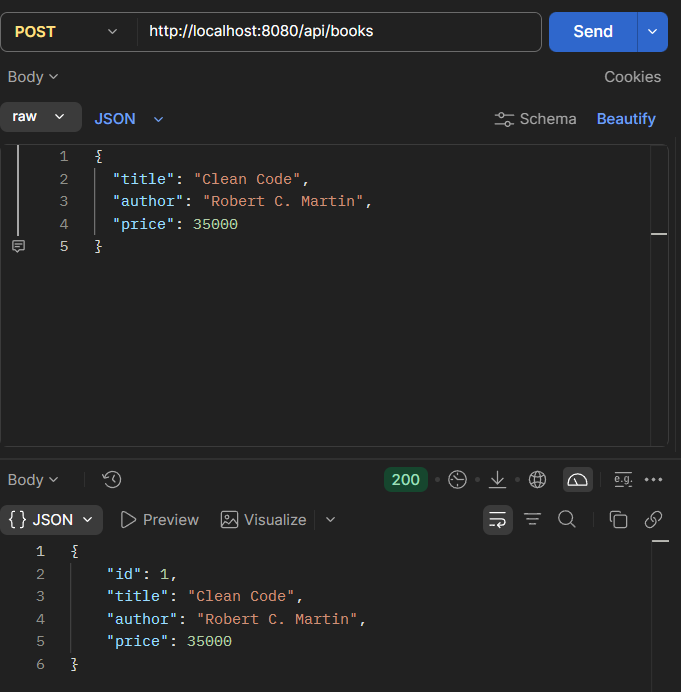
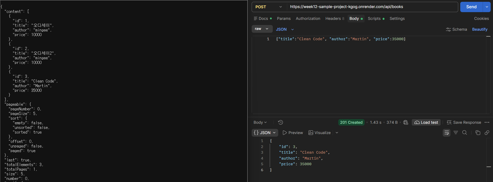
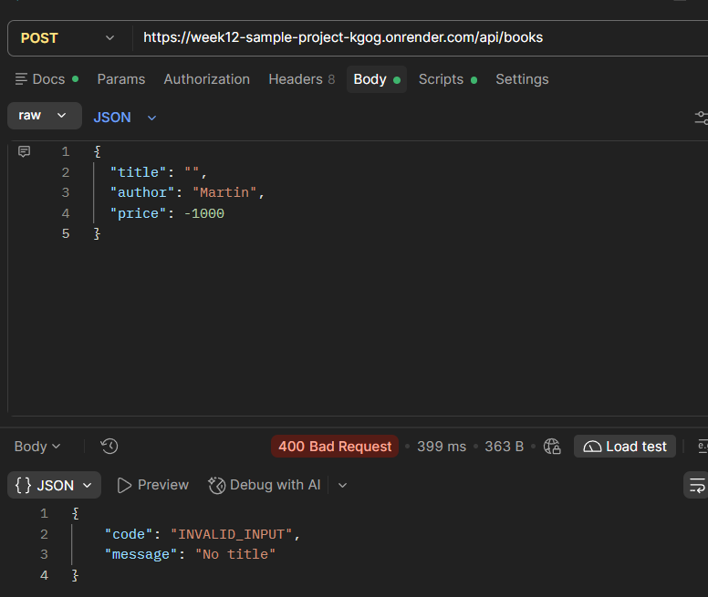
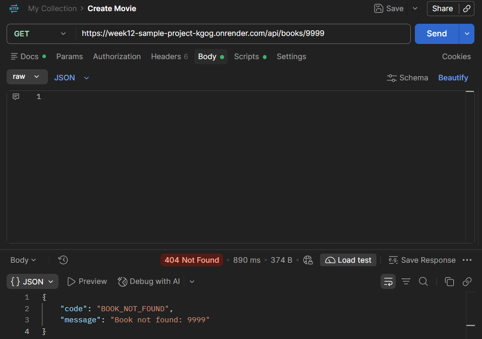
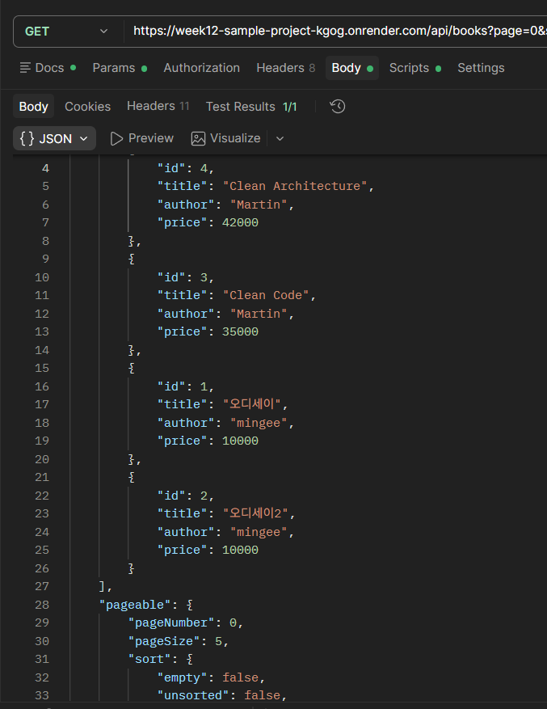
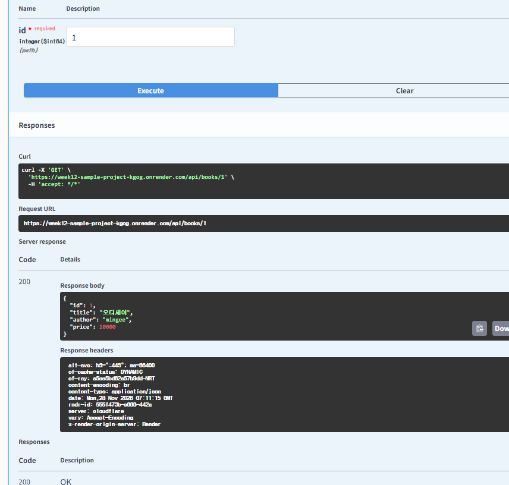

## 12주차 과제 프로젝트 

# Spring Boot와 JPA 기반 도서 REST API를 DTO, Validation, 예외 처리, 페이징, Swagger로 고도화하고 Render에 배포한 프로젝트
GitHub Repository URL: https://github.com/2026-2-WebService/assign12-c01-22200439
Render Deployment URL: https://week12-sample-project-kgog.onrender.com
Swagger UI URL: https://week12-sample-project-kgog.onrender.com/swagger-ui.html

# Installation & Execution
개발 환경: Java 17, Spring Boot 3.5.7, MariaDB, Gradle
실행 방법:
터미널이나 IntelliJ에서 설정해야 하는 환경 변수 5가지 안내 (SPRING_PROFILES_ACTIVE, DB_URL, DB_USERNAME, DB_PASSWORD, DDL_AUTO)
실행 명령어: ./gradlew bootRun (윈도우는 .\gradlew.bat bootRun)

# Source Code Exploration & Analysis
- Project Structure & JPA

1. BookController, BookService, BookRepository의 역할과 요청 처리 흐름을 설명하세요.
BookController: 클라이언트의 HTTP 요청을 받고 입력값을 검증하며, 적절한 HTTP 응답을 반환하는 프레젠테이션 계층.
BookService: 도서 등록, 수정, 조회, 삭제 시의 비즈니스 로직과 데이터 변환, 예외 발생 등을 담당하는 서비스 계층.
BookRepository: 데이터베이스와 통신하여 데이터 CRUD를 수행하는 데이터 접근 계층. 
클라이언트 요청 → Controller에서 요청 수신 및 검증 → Service 호출하여 비즈니스 로직 처리 → Repository를 통해 DB 연동 → 처리 결과를 Controller로 반환 → Controller가 ResponseEntity로 최종 HTTP 응답 반환.

2. JpaRepository<Book, Long>만 선언해도 findAll(), save()를 사용할 수 있는 이유를 설명하세요.
Spring Data JPA의 기본 동작 원리 때문. 인터페이스만 선언해 두면 애플리케이션 실행 시점에 스프링이 동적 프록시기술을 사용하여 인터페이스 구현체를 런타임에 자동으로 생성해 Bean으로 등록.
JpaRepository가 상속하는 상위 인터페이스에 이미 save(), findAll(), findById() 등의 기본 CRUD 메서드가 정의되어 있어 별도 구현 없이 바로 호출.

- DTO & HTTP Response

3. 기존 API가 Book Entity를 직접 요청·응답에 사용할 때 발생할 수 있는 문제를 설명하세요.
보안 및 은닉성 문제: 엔티티가 외부에 그대로 노출되어 DB 테이블 구조가 드러나며, 클라이언트가 서버에서 자동 생성해야 하는 id를 임의로 전송해 조작할 위험이 있음.
결합도 증가: 엔티티 구조가 바뀌면 프론트엔드/외부 API 스펙까지 영향을 받아 유지보수가 어려워짐.
유효성 검증 한계: 엔티티에 등록용, 수정용 등 서로 다른 검증 규칙을 한 번에 정의하기 어려움.
4. Request DTO와 Response DTO를 분리하는 이유와 ResponseEntity가 필요한 상황을 설명하세요.
DTO 분리 이유: 등록/수정 요청시에는 클라이언트로부터 받을 필드만 제한하고 검증을 걸어야 하며, 응답 시에는 생성된 ID나 화면에 필요한 데이터만 안전하게 가공해서 전달해야 하므로 각각의 책임과 데이터 형태가 다르다.
ResponseEntity가 필요한 상황: 단순 데이터 반환을 넘어, HTTP 표준 상태 코드나 응답 헤더를 개발자가 명시적이고 세밀하게 제어해야 할 때 필요.
- Validation & Exception Handling

5. @Valid, @NotBlank, @Min은 각각 어느 시점에 어떤 동작을 수행하나요?
@Valid: 컨트롤러 메서드가 호출되면서 HTTP 요청 JSON이 DTO 객체로 역직렬화되는 시점에 DTO 내부에 선언된 조건 검증을 실행시키는 트리거 역할. 실패 시 MethodArgumentNotValidException이 발생.
@NotBlank: 검증 시점에 해당 문자열 필드가 null이 아니고, 공백을 제거한 길이가 0보다 큰지 검사.
@Min: 검증 시점에 해당 숫자 필드가 지정한 최솟값 이상인지 검사하여 음수 입력을 방지.
6. @RestControllerAdvice와 @ExceptionHandler를 사용하면 예외 처리 흐름이 어떻게 바뀌나요?
이전: 각 컨트롤러나 메서드마다 개별적으로 try-catch를 작성해야 했고, 처리되지 않은 예외는 기본 에러 페이지로 떨어져 일관성이 없었음.
이후: 컨트롤러 계층 전역에서 발생하는 예외를 @RestControllerAdvice가 가로채고, 발생한 예외 타입에 매핑된 @ExceptionHandler 메서드가 실행되어 일관된 공통 JSON 응답 포맷과 적절한 상태 코드를 반환하도록 흐름이 바뀜.
- Pagination & OpenAPI

7. Pageable과 Page<T>는 각각 어떤 역할을 하며 sort=price,desc는 어떻게 처리되나요?
Pageable: 클라이언트가 전달한 페이지 요청 정보를 담아 서비스와 리포지토리로 전달하는 인터페이스.
Page<T>: DB에서 조회된 실제 데이터 목록과 함께 전체 데이터 수, 전체 페이지 수, 현재 페이지 번호 등의 페이징 메타데이터를 함께 제공하는 응답 객체.
sort=price,desc 처리: Spring MVC의 파라미터 리졸버가 이를 Sort 객체로 파싱하여 Pageable에 담고, JPA 리포지토리 실행 시 SQL의 ORDER BY price DESC 문장으로 자동 변환.
8. /v3/api-docs와 /swagger-ui.html의 역할을 구분해서 설명하세요.
/v3/api-docs: 애플리케이션의 REST API 명세를 OpenAPI 3 규격에 맞춘 순수 JSON 데이터 형태로 제공하는 엔드포인트.
/swagger-ui.html: /v3/api-docs의 JSON 데이터를 읽어와 웹 브라우저에서 개발자가 직관적으로 볼 수 있도록 렌더링해 주는 시각적 웹 UI. 웹 화면에서 직접 요청을 전송해 테스트할 수 있는 기능을 제공.
# Line-by-Line Code Comments
BookController.list()
//쿼리 파라미터를 객체로 받아서 service.findAll(pageable)을 호출하고, 조회된 Page<BookResponse>를 200로 반환한다.
public ResponseEntity<Page<BookResponse>> list(@PageableDefault(size = 5, sort = "id", direction = Sort.Direction.ASC) Pageable pageable) {
    return ResponseEntity.ok(service.findAll(pageable));
}

BookController.create()
// @RequestBody 로 요청을 DTO보 변환해 받고, @Valid로 입력값을 검증한다.
public ResponseEntity<BookResponse> create(@Valid @RequestBody BookRequest input) {
    //도서를 저장하고, 결과를 DTO로 받아 Response Entity를 통해 201과 Response Body에 담아 반환한다
    return ResponseEntity.status(HttpStatus.CREATED).body(service.create(input));
}

BookService.findAll()
public Page<BookResponse> findAll(Pageable pageable) {
    // Page<Book>을  조회, .map(BookResponse::from)를 통해 각 엔티티를 DTO로 변환하여 Page<BookResponse>로 반환한다.
    return repository.findAll(pageable).map(BookResponse::from);
}

BookService.findById()
public Book findById(Long id) {
    // 데이터 베이스에서 해당 ID의 도서를 optional 형태로 조회하고, 데이터가 존대하지 않으면 .orElseThrow()로 404처리
    return repository.findById(id).orElseThrow(() -> new BookNotFoundException(id));
}

# Refactoring & New Features
요청/응답 DTO 분리:
Book 엔티티를 컨트롤러 파라미터와 반환값으로 직접 노출하여, 서버가 자동 생성해야 할 id가 요청에 포함될 수 있는 구조에서
요청 전용 BookRequest와 응답 전용 BookResponse로 분리하여 데이터 캡슐화 및 보안성 강화.
HTTP 응답 상태 코드:
모든 요청에 대해 기본 상태 코드인 200 OK만 반환됨. -> ResponseEntity를 적용하여 POST 성공 시 201 Created, GET/PUT 성공 시 200 OK, DELETE 성공 시 204 No Content를 명시적으로 반환하도록 변경.
- New Features
  Bean Validation: BookRequest의 제목/저자에 @NotBlank, 가격에 @Min(0)을 붙여 잘못된 입력이 들어오면 400 Bad Request 처리.
  공통 예외 처리: GlobalExceptionHandler(@RestControllerAdvice)에서 없는 도서 조회 시 BookNotFoundException(404), 입력값 오류 시 MethodArgumentNotValidException(400)을 가로채어 ApiError(code, message) JSON으로 응답.
  페이징 및 정렬: Pageable과 @PageableDefault를 적용해 GET /api/books?page=0&size=5&sort=price,desc 호출 시 정렬 및 Page<BookResponse> 메타데이터 제공.
  Swagger: springdoc-openapi를 추가하여 /swagger-ui.html 인터랙티브 문서 제공 및 @Tag, @Operation으로 API 설명 추가.
# Testing & Deployment
1) 01_sample.png (초기 Sample CRUD 테스트)

2) 02_dto_created.png (DTO 적용 후 POST 성공 - 201 Created)

3) 03_validation.png (입력 검증 실패 - 400 Bad Request)

4) 04_not_found.png (존재하지 않는 ID 조회 - 404 Not Found)

5) 05_pagination.png (페이징 및 가격 정렬 결과)

6) 06_swagger.png (Swagger UI 테스트 화면)

배포 URL: https://week12-sample-project-kgog.onrender.com
Swagger UI URL: https://week12-sample-project-kgog.onrender.com/swagger-ui.html

Render 배포 후 POST /api/books 호출 시 500 Internal Server Error 발생. Logs를 확인하여 Field 'category' doesn't have a default value 에러 확인.
DBeaver를 통해 MariaDB 서버에 접속하여 ALTER TABLE books DROP COLUMN category; 쿼리를 실행해 엔티티 필드와 DB 스키마를 일치시켜 201 Created되도록 해결함.

# Weekly Review
1. 새롭게 배운 내용 3가지
- @Valid와 Bean Validation 어노테이션(@NotBlank, @Min)을 통한 자동 입력값 검증 원리
- Pageable과 @PageableDefault를 활용하여 정렬 및 페이징된 Page<T> 데이터를 반환하는 방법
- springdoc-openapi를 적용하여 Swagger로 실시간 API 문서를 시각화하고 테스트하는 방법

2. 어려웠던 점과 해결 방법
Render 배포 후 POST 호출 시 500 에러가 발생했으나, Render의 로그를 추적하여 이전 실습 때 MariaDB에 남아있던 category NOT NULL 컬럼 때문임을 파악하고, DBeaver로 ALTER TABLE books DROP COLUMN category;를 실행해 스키마를 맞춰 해결함.
3. AI 활용 내용 및 느낀 점
활용 내용: Dockerfile의 Java 버전 불일치 빌드 에러 원인 분석, Spring Boot 3.5 호환 의존성 설정 가이드, Render 로그에 찍힌 MariaDB category 기본값 오류 해결 방법 탐색 등에 AI를 활용함.
느낀 점: 컨트롤러나 서비스 파일 안에 따로따로 예외 처리 코드를 집어넣지 않고, @RestControllerAdvice 하나로 공통 에러 포맷을 통일하여 처리하는 구조가 코드의 가독성, 유지보수를 좋게 해준다는 걸 느꼈다. 